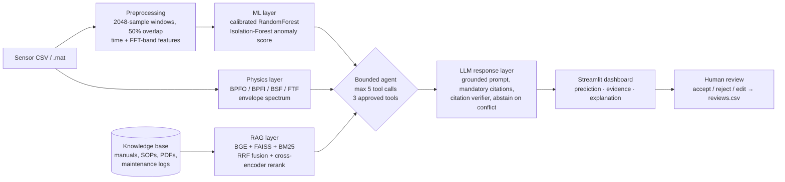
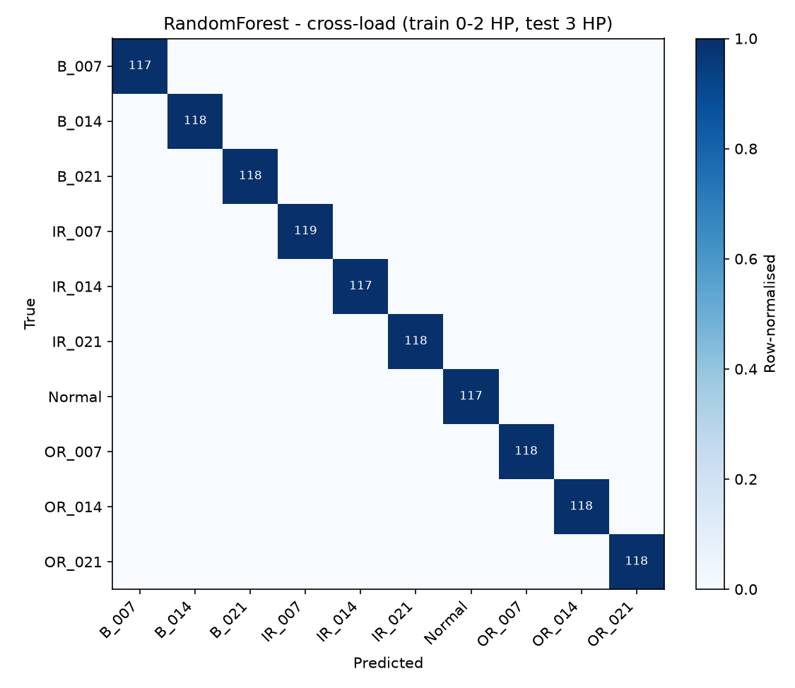

<<<<<<< HEAD
# IntelliMaintain ⚙️

**An evidence-grounded AI copilot for industrial predictive maintenance of rolling-element bearings.**

IntelliMaintain takes a raw vibration signal, classifies the bearing condition with a calibrated ML model,
cross-checks the prediction against bearing physics (envelope spectrum at the defect frequencies), retrieves
supporting passages from maintenance manuals and work-order logs with hybrid RAG, and lets an LLM agent write a
**cited, advisory explanation** that a human engineer accepts, rejects or edits.

> Final-year project, Dept. of CSE, M S Ramaiah University of Applied Sciences (Batch 26PB58)
> Guide: Ms. Shona M · Team: Archana G Soner, Guru Raghav K K, Kavin M, Pranjal H Muchandi

---

## Why this project is different

| Typical CWRU project | IntelliMaintain |
|---|---|
| One model | Feature **RandomForest** *and* image-based **spectrogram CNN**, compared on identical splits, with a control experiment showing what really causes the CNN's noise robustness |
| Random split, reports ~100 % accuracy | Random **and** cross-load **and** leave-one-load-out **and** cross-severity **and** noise tests – shows *where* the model breaks |
| Mixes 48 kHz "Normal" files with 12 kHz fault files (a known CWRU pitfall) | Normal baseline is anti-alias resampled 48 → 12 kHz |
| Label only | Calibrated confidence (ECE 0.120 → 0.016), anomaly score, physics cross-check |
| Chatbot answers from memory | Answers **only** from retrieved evidence; every sentence cited `[n]`, `[ML]`, `[PHYS]`; invalid citations removed automatically; "insufficient evidence" when unsupported |
| Trusts the ML model blindly | Envelope-spectrum physics check flags **80 %** of injected wrong predictions and cuts confidently-wrong answers from 100 % to 33 % |
| No evaluation of the LLM part | 2 × 3 ablation, C0 vs C1, wrong-ML stress test, retrieval benchmark, optional LLM-as-judge |
| Paid LLM APIs | **Google Gemini on the free API tier** (rate-limit aware), with an automatic offline fallback so it never breaks |

## Architecture



The agent's three tools (`intellimaintain/agent/tools.py`):

| Tool | Returns | Owner |
|---|---|---|
| `classify_signal(signal)` | `ClassifyResult` – class, fault type, calibrated confidence, probabilities, anomaly score, indicators | P1 |
| `fault_frequency_calc(rpm, signal)` | `FaultFrequencies` – defect frequencies, envelope SNR, physics verdict, consistency with ML | P1/P3 |
| `retrieve_evidence(query)` | `list[EvidenceChunk]` – passage, source file, page number, score | P2 |

All data contracts live in `intellimaintain/schemas.py` (`ClassifyResult`, `EvidenceChunk`, `FaultFrequencies`,
`ToolCall`, `Diagnosis`).

---

## Quick start (VS Code, Windows / macOS / Linux)

Requires **Python 3.10 – 3.12** and Git.

1. **Clone** – in VS Code press `Ctrl+Shift+P` → *Git: Clone* → choose this repository → open the folder.
2. **Create a virtual environment** – open a terminal (`` Ctrl+` ``):
   ```bash
   python -m venv .venv
   # Windows:
   .venv\Scripts\activate
   # macOS / Linux:
   source .venv/bin/activate
   pip install -r requirements.txt
   ```
   (VS Code: `Ctrl+Shift+P` → *Python: Select Interpreter* → pick `.venv`.)
3. **Build everything** (downloads ~130 MB CWRU data, trains, downloads the BGE model and open PDFs, builds the
   index, runs the evaluation – about 3-5 minutes):
   ```bash
   python scripts/setup_all.py
   ```
4. **Run the app**
   ```bash
   streamlit run app/app.py
   ```
   or use the VS Code *Run and Debug* panel → **IntelliMaintain: Streamlit app**.
5. **Run the tests**
   ```bash
   python -m pytest
   ```

The repository already ships a trained classifier, a starter index and demo samples, so `streamlit run app/app.py`
works right after `pip install` – `setup_all.py` upgrades the index to BGE embeddings and adds the real PDFs.

### The LLM: Google Gemini (free)

1. Get a free API key at **https://aistudio.google.com/apikey** (Google account, no credit card).
2. Copy `.env.example` to `.env` and paste it: `GEMINI_API_KEY=your-key`
3. Restart the app – the sidebar now shows **Provider: gemini**. Click **Test LLM connection**.

| Model (sidebar) | Use |
|---|---|
| `gemini-3.5-flash-lite` (default) | fastest, largest free quota – best for demos and evaluation runs |
| `gemini-3.8-flash` | richer explanations, smaller free quota |

Free-tier protection: calls are paced (`IM_LLM_RPM`, default 8/min) and "rate limit" answers are retried after the
delay Gemini asks for. If there is no key, the key is invalid, or the daily quota is used up, the agent switches to
the **offline** extractive generator and says so in the warnings – the demo never crashes.

---

## Online or offline – the facts always come from the data

| | With internet (Gemini) | Without internet (offline) |
|---|---|---|
| Fault type, confidence | ML classifier trained on CWRU + physics check | same |
| Similar cases | 3 closest CWRU recordings (case-based evidence) | same |
| Evidence | hybrid search over the manuals, PDFs and logs | same |
| Who writes the text | Gemini, **then verified** | offline extractive generator |

Gemini can never change the facts: (1) the fault type is locked to the classifier/physics result; (2) every
sentence must cite a source and share enough words with it; (3) every number must appear in the cited source;
(4) unverifiable sentences are removed, and if less than half of the answer can be verified the verified offline
answer is shown instead. The app shows "✅ verified against the data" and a grounding score for every Gemini answer.

## Ask in your own words

Questions can be typed like a chat message – typos, short forms and everyday words are understood
(`intellimaintain/agent/nlu.py`, works offline):

| You type | Understood as |
|---|---|
| `yo my bering is makin weird grindin noise wat shud i do??` | bearing + vibration/impacting → guidance, and a request to upload a recording |
| `how often shud i oil it` | lubrication / relubrication interval |
| `is ths bearing ok?` (with a signal) | full diagnosis of the uploaded signal |
| `can i keep running it till friday` | severity / urgency of the diagnosed fault |
| `hi`, `thanks`, `what can u do` | friendly reply, no tools run |
| `best chicken biryani recipe` | out of scope → "insufficient evidence" (no made-up answer) |

On 24 informal test questions (`eval/casual_questions.csv`) the intent is recognised for 100 %, and the
language layer raises "relevant document in the top 5" from 80 % to 100 % (run `python scripts/run_eval.py`).
With Gemini, the original wording is also passed to the LLM, which handles other languages too; the answer is
given in English so it can be verified against the English sources.

## Working without internet

After the one-time setup (which needs internet to install packages and download CWRU, BGE and the reranker),
everything runs **offline** except Gemini: the classifier, CNN, physics check, hybrid search over the manuals,
the dashboard, the review log and the evaluation. Choose **Provider: offline** (or simply have no internet) and the
copilot writes its cited answer with the offline extractive generator. Hugging Face models are loaded from the local
cache automatically when there is no connection.

## Keeping the API key secret

* The key lives **only** in `.env` (laptop) or the app's **Secrets** (online). Both are git-ignored / server-side.
* The interface has **no key field** and never displays the key – only "Gemini key: configured".
* The key is sent to Google in a request **header**, never in a URL, so it cannot appear in logs or error messages.
* Every error, warning, report and review-log entry passes through `redact()`; anything shaped like a Google key
  becomes `***hidden***`. Tracebacks are hidden from viewers (`showErrorDetails = false`).
* `python scripts/check_secrets.py --install-hook` blocks any git commit that contains a key;
  `prepare_deploy.py` and the test suite (`tests/test_security.py`) run the same scan.
* A public link cannot drain your free quota: each visitor session gets at most 30 Gemini diagnoses
  (`IM_MAX_LLM_RUNS_PER_SESSION`), then the offline generator answers.
* If a key is ever exposed, delete it at aistudio.google.com/apikey and create a new one.

## Run it online (free, shareable link)

The app runs on **Streamlit Community Cloud** straight from your GitHub repository.

1. On your laptop (after training): `python scripts/prepare_deploy.py`
   – checks that models, index and samples exist and pins the scikit-learn version the models were trained with.
2. Commit and push everything to GitHub, **including** `models/` and `data/samples/`
   (the online server cannot download CWRU or train). Your `.env` is never pushed.
   If `data/corpus/pdf/` was indexed, keep the repository **private** (manufacturer text is inside the index).
3. Go to **https://share.streamlit.io** → sign in with GitHub → **Create app** → choose the repository,
   branch `main`, main file **`app/app.py`**.
4. **Advanced settings** → Python version as printed by `prepare_deploy.py` (e.g. 3.12) →
   **Secrets**:
   ```toml
   GEMINI_API_KEY = "your-key"
   ```
5. **Deploy**. The first start takes a few minutes (installs CPU-only PyTorch from `app/requirements.txt`,
   downloads the BGE model). You get a link like `https://intellimaintain.streamlit.app` to share.

Every `git push` redeploys automatically. If the server runs out of memory, add `IM_RERANK_MODEL = "none"` to the
Secrets (skips the cross-encoder; hybrid retrieval still works).

### Troubleshooting

| Problem | Fix |
|---|---|
| `Step failed: 5/6 Build the RAG index` with no Python error (macOS) | PyTorch and FAISS OpenMP clash – fixed in code (FAISS is imported after PyTorch, `KMP_DUPLICATE_LIB_OK`, `OMP_NUM_THREADS=1` on macOS). Re-run `python scripts/build_index.py` |
| `OMP: Error #15 ... already initialized` | `export KMP_DUPLICATE_LIB_OK=TRUE` (Windows: `set KMP_DUPLICATE_LIB_OK=TRUE`) |
| `SSL: CERTIFICATE_VERIFY_FAILED` during downloads | `pip install --upgrade certifi` |
| A PDF shows `[fail]` | open the printed link in a browser and save the file into `data/corpus/pdf/` |
| "Model trained with scikit-learn X" warning | `python scripts/train_ml.py` (30 s) |
| Any step failed | re-run only that script (e.g. `python scripts/build_index.py`) to see the full error |

## Results (CWRU 12 kHz drive end, 10 classes, 4 643 windows from 40 recordings)

Full tables: [`reports/ml_results.md`](reports/ml_results.md) and [`reports/eval_results.md`](reports/eval_results.md).

### ML layer

| Experiment | Accuracy | Macro-F1 |
|---|---|---|
| Random 80/20 window split – RandomForest | 1.000 | 1.000 |
| **Cross-load** (train 0-2 HP → test 3 HP) – RandomForest | 1.000 | 1.000 |
| Cross-load – XGBoost | 0.990 | 0.990 |
| Leave-one-load-out (mean of 4 folds) | 0.9995 | – |
| **Cross-severity** (4 fault types, train 0.007/0.014", test unseen 0.021") | **0.427** | 0.394 |
| Cross-load with 10 dB / 5 dB / 0 dB added noise | 0.804 / 0.406 / 0.208 | – |

| Calibration (cross-load test) | ECE | Brier |
|---|---|---|
| Raw RandomForest probabilities | 0.120 | 0.037 |
| Isotonic-calibrated (folds grouped by load) | **0.016** | **0.003** |

**Key finding.** Exactly as reported in the literature (Hou et al., 2020), CWRU accuracy is saturated on the
standard splits. Under realistic shift – an unseen defect size or noise – the classifier collapses (inner- and
outer-race 0.021" faults are mistaken for ball faults). This motivates the physics cross-check and the human review
step: the envelope check alone identifies **100 %** of inner-race recordings and **100 %** of healthy recordings,
independently of the ML model.



### RandomForest vs spectrogram CNN (image input)

Each 2048-sample window is converted to a 64 × 64 log-power STFT image and classified by a small CNN
(4 conv blocks, ~61 k parameters, trained in ~1 min per split on a laptop CPU). Full table:
[`reports/cnn_results.md`](reports/cnn_results.md).

| Cross-load test (3 HP) with added noise | RF | RF + noise augmentation | CNN | CNN + noise augmentation |
|---|---|---|---|---|
| clean | 1.000 | 0.995 | 1.000 | 1.000 |
| 10 dB | 0.804 | 0.998 | 0.472 | 0.998 |
| 5 dB | 0.406 | 0.965 | 0.318 | 0.975 |
| 0 dB | 0.208 | 0.691 | 0.101 | 0.762 |

**Finding:** the large gain in noise robustness comes mainly from **training-time noise augmentation**, not from
the CNN itself; with identical augmentation the CNN is only clearly better under extreme noise (0 dB). Neither model
generalises to an unseen defect size (cross-severity ≈ 0.43 for both), so that is a data limitation, not a model
limitation – which is why the physics cross-check and human review remain essential.


### Copilot (agent + RAG + LLM), 20 test cases – offline generator, LSA starter index

| Configuration | Fault correct | Key-fact recall | Citation coverage | Faithfulness |
|---|---|---|---|---|
| C0: no ML, no retrieval (LLM only) | 0.00 | 0.05 | 0.00 | – |
| C1: no ML, basic RAG | 0.10 | 0.73 | 0.79 | 0.88 |
| no ML, improved RAG | 0.10 | 0.73 | 0.80 | 0.89 |
| ML, no retrieval | **1.00** | 0.35 | 0.50 | 0.97 |
| ML + basic RAG | **1.00** | **1.00** | 0.89 | 0.93 |
| **ML + improved RAG (full system)** | **1.00** | **1.00** | **0.89** | **0.93** |

**Wrong-ML stress test** (30 confident wrong labels injected): 80 % flagged for human review; with the
*abstain-on-conflict* policy the share of confidently wrong final answers drops from **100 % to 33 %**, with
**zero** cost on correct predictions.

Re-run with a real LLM to fill the remaining cells of the research questions:
```bash
python scripts/run_eval.py --provider gemini --judge    # adds LLM-as-judge (RAGAS-style) scores
```

---

## Project structure

```
intellimaintain/
├── app/app.py                      # Streamlit dashboard (P4)
├── intellimaintain/
│   ├── config.py                   # all paths & hyper-parameters (.env overrides)
│   ├── schemas.py                  # ClassifyResult, EvidenceChunk, FaultFrequencies, Diagnosis
│   ├── ml/                         # P1
│   │   ├── cwru.py                 #   dataset catalogue, download, 48k→12k resampling
│   │   ├── features.py             #   windowing + RMS, kurtosis, skewness, crest factor, FFT band energy …
│   │   ├── physics.py              #   BPFO/BPFI/BSF/FTF, envelope spectrum, ML-vs-physics cross-check
│   │   ├── train.py                #   all experiments, figures, calibrated model
│   │   ├── spectrogram.py          #   window -> 64x64 log-power STFT image
│   │   ├── cnn.py / train_cnn.py   #   spectrogram CNN, temperature scaling, RF-vs-CNN experiments
│   │   ├── classifier.py           #   classify_signal() -> ClassifyResult
│   │   └── signal_io.py            #   robust CSV/.mat/.npy reader
│   ├── rag/                        # P2
│   │   ├── ingest.py               #   PDF/markdown parsing with page numbers, 600-token chunks, 100 overlap
│   │   ├── embed.py                #   BGE (sentence-transformers) with TF-IDF/LSA fallback
│   │   └── retriever.py            #   FAISS + BM25 + RRF + cross-encoder; retrieve_evidence()
│   ├── agent/                      # P3
│   │   ├── tools.py                #   the 3 approved tools
│   │   ├── prompts.py              #   grounded, cite-everything prompt + planner prompt
│   │   ├── llm.py                  #   Google Gemini (free API) + offline fallback
│   │   ├── agent.py                #   bounded loop (fixed or LLM planner), abstain-on-conflict
│   │   ├── verify.py               #   citation verification & coverage
│   │   └── extractive.py           #   offline citation-safe generator
│   └── evaluation/evaluate.py      # P4: ablation, C0 vs C1, stress test, retrieval benchmark
├── data/corpus/                    # knowledge base (+ pdf/ downloaded locally)
├── data/samples/                   # demo CSVs (held-out 3 HP recordings)
├── eval/test_cases.csv             # shared test-case sheet (20 cases)
├── models/                         # trained classifier + RAG index
├── reports/                        # auto-generated results + figures
├── scripts/                        # setup_all, download_*, train_ml, build_index, run_eval, diagnose …
└── tests/                          # 50+ pytest tests incl. headless Streamlit app tests
```

### Useful commands

| Command | What it does |
|---|---|
| `python scripts/train_ml.py` | Feature extraction + all ML experiments + figures + model |
| `python scripts/train_cnn.py` | Spectrogram CNN on the same splits + RF-vs-CNN table + figures |
| `python scripts/build_index.py` | Parse corpus, chunk, embed with BGE, store in FAISS, run the test query |
| `python scripts/diagnose.py data/samples/outer_race_007_3hp.csv` | Command-line diagnosis |
| `python scripts/diagnose.py --question "What does kurtosis 8 mean?"` | Ask the knowledge base only |
| `python scripts/run_eval.py --provider gemini` | Full evaluation with Gemini (paced for the free tier) |
| `python scripts/prepare_deploy.py` | Check everything is ready for the online deployment |
| `python scripts/run_eval.py --classifier cnn` | Same evaluation with the CNN as the agent's classifier |
| `python -m pytest` | 50+ tests (ML, RAG, agent, mocked LLM APIs, Streamlit UI) |

---

## Team work split (from the project plan)

| Member | Part | Main files |
|---|---|---|
| P1 | ML | `ml/`, `scripts/train_ml.py`, `reports/ml_results.md` |
| P2 | RAG | `rag/`, `data/corpus/`, `scripts/build_index.py`, `scripts/download_corpus.py` |
| P3 | Agent & LLM | `agent/`, `scripts/diagnose.py` |
| P4 | Evaluation & app | `app/app.py`, `eval/test_cases.csv`, `evaluation/`, `scripts/run_eval.py` |

## Limitations and honest notes

* The starter knowledge base (`kb01`–`kb10`) was written by the team; `kb09` maintenance logs are **synthetic**.
  Real manufacturer PDFs are downloaded locally by `scripts/download_corpus.py` and are not redistributed.
* CWRU faults are artificially seeded (EDM) on one test rig; results do not transfer automatically to field data.
* The envelope check cannot confirm ball faults (well documented for CWRU – Smith & Randall, 2015), and some
  0.014" outer-race recordings show inner-race-like envelope content, so "inconclusive" is reported instead of a guess.
* The output is **advisory**. A qualified engineer must review it before any maintenance decision.

## Future work

Multimodal RAG (diagrams/tables), domain-adaptation for unseen defect sizes, Paderborn dataset, remaining useful
life on C-MAPSS, blind human ratings of explanation utility.

## References

1. Case Western Reserve University Bearing Data Center – https://engineering.case.edu/bearingdatacenter
2. W. A. Smith, R. B. Randall (2015). Rolling element bearing diagnostics using the CWRU data: a benchmark study. *MSSP* 64-65.
3. P. Lewis et al. (2020). Retrieval-augmented generation for knowledge-intensive NLP tasks. *NeurIPS*.
4. S. Es et al. (2024). RAGAs: Automated evaluation of retrieval augmented generation. *EACL demos*.
5. L. Hou et al. (2020). Input feature mappings-based deep residual networks for fault diagnosis … *IEEE Access* 8.
6. C. Harbola, A. Purwar (2025). Prescriptive agents based on RAG for automated maintenance (PARAM). arXiv:2508.04714.
7. S. Xiao et al. (2023). C-Pack: Packaged resources to advance general Chinese embedding (BGE models). arXiv:2309.07597.
# IntelliMaintain
# IntelliMaintain
=======
# IntelliMaintain
>>>>>>> 126f5118a5320bbf1986c4bda0c799bc57e26d3a
