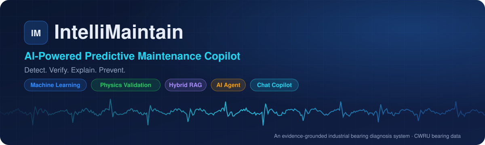
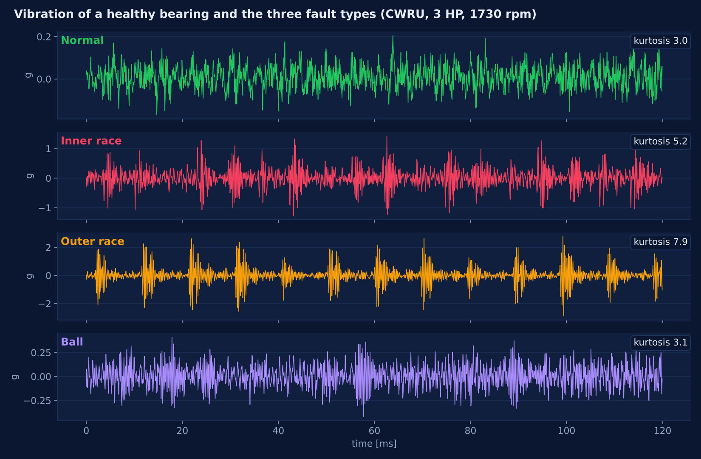
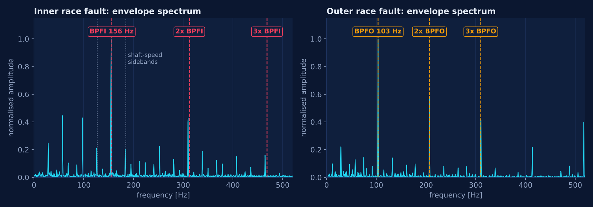
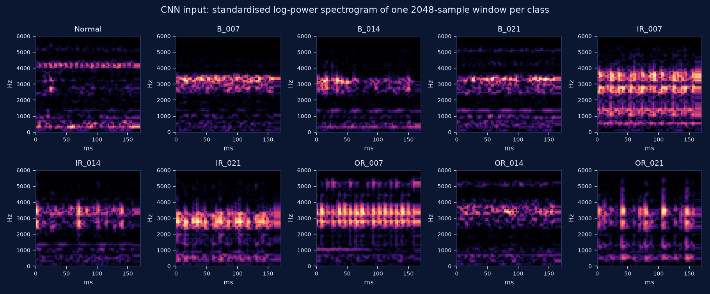
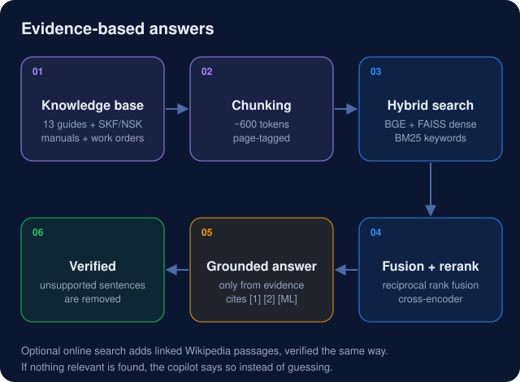
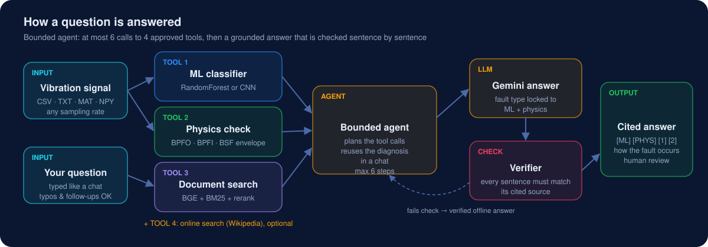
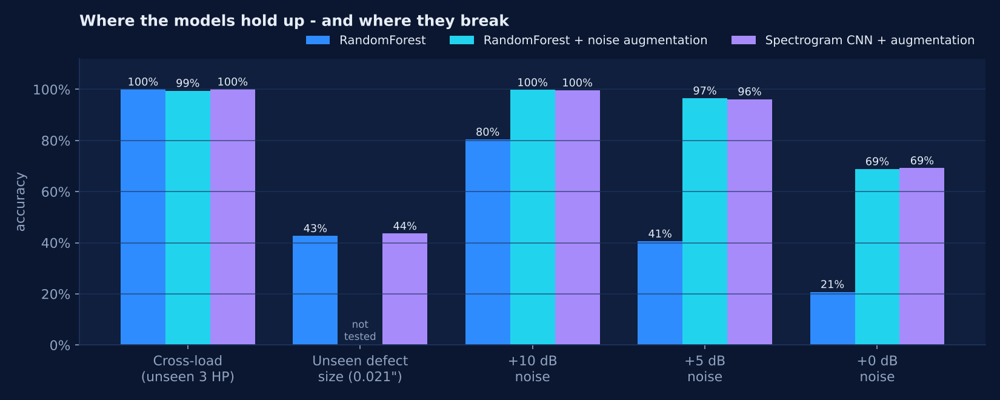
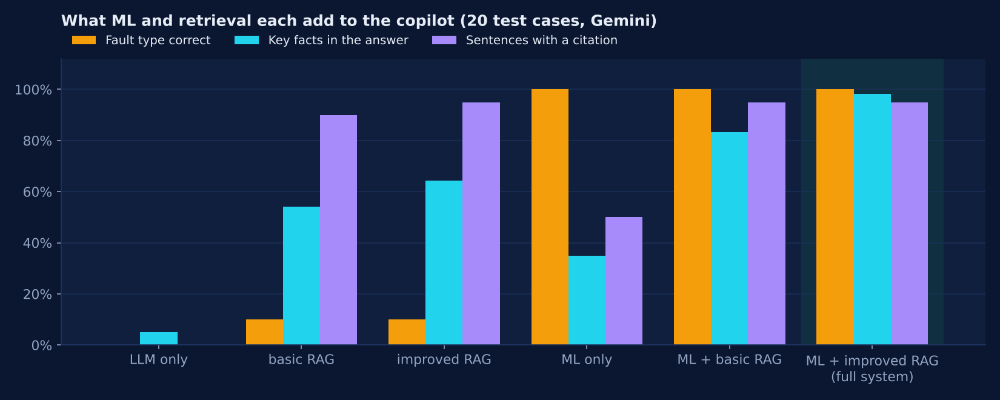

<p align="center">
  
</p>

<p align="center">
  
  
  
  
  
  
</p>

<p align="center">
  <b>IntelliMaintain</b> listens to a bearing's vibration, tells you what is wrong, checks that answer against
  physics, and explains it in plain words &mdash; with a source for every sentence.
</p>

<p align="center">
  <a href="#how-it-works">How it works</a> ·
  <a href="#chat-with-the-copilot">Chat</a> ·
  <a href="#results">Results</a> ·
  <a href="#quick-start">Quick start</a> ·
  <a href="#project-structure">Structure</a> ·
  <a href="#team">Team</a>
</p>

> Final-year project · Dept. of CSE · M S Ramaiah University of Applied Sciences · Batch **26PB58**<br>
> Guide: **Ms. Shona M**

---

## Why it matters

Rolling-element bearings are one of the most common reasons rotating machines stop without warning. Engineers
already record vibration, but reading it takes an expert, and turning a diagnosis into the right maintenance action
means searching through manuals. IntelliMaintain does both steps and keeps a human in charge:

| | A typical student project | IntelliMaintain |
|---|---|---|
| **Diagnosis** | one model, ~100 % on a random split | RandomForest **and** spectrogram CNN, tested on unseen loads, unseen defect sizes and heavy noise |
| **Trust** | the model is taken at its word | calibrated confidence, anomaly score and an independent **physics check** that can overrule the model |
| **Explanation** | a chatbot answering from memory | answers **only from retrieved evidence**; every sentence is cited and automatically verified |
| **Interaction** | one fixed question | a **chat**: ask anything, ask follow-ups, get an answer to *that* question |
| **Cost** | paid APIs | free Gemini tier with an offline fallback, so the app never stops working |

---

## How it works

<table>
<tr>
<td width="50%" valign="top">

<h3>01 · Signal analysis</h3>
A damaged bearing "ticks" every time a ball rolls over the defect. Each recording is cut into 2048-sample
windows; 29 features per window (RMS, kurtosis, crest factor, spectral shape, 16 band energies) capture those
impacts. A healthy bearing stays near kurtosis 3; faults push it up.
</td>
<td width="50%" valign="top">

<h3>02 · Physics verification</h3>
The ticks repeat at a rate set by the bearing geometry and shaft speed: <b>BPFO</b> (outer race),
<b>BPFI</b> (inner race), <b>2×BSF</b> (ball). The envelope spectrum shows which rate is present, so the
physics check can confirm the model &mdash; or flag it for an analyst.
</td>
</tr>
<tr>
<td width="50%" valign="top">

<h3>03 · ML intelligence</h3>
A calibrated <b>RandomForest</b> on the features and a <b>spectrogram CNN</b> on 64×64 time-frequency images,
compared on identical splits. Each prediction comes with a calibrated confidence, an anomaly score and the
three most similar CWRU recordings.
</td>
<td width="50%" valign="top">

<h3>04 · Evidence-based AI</h3>
Hybrid search (BGE embeddings + BM25, fused and reranked) finds passages in maintenance guides, manufacturer
manuals and work orders. Gemini writes the answer from that evidence only; sentences that do not match their
cited source are removed.
</td>
</tr>
</table>

### The full pipeline

<p align="center"></p>

The agent can call four approved tools and nothing else:

| Tool | What it returns |
|---|---|
| `classify_signal` | fault class, calibrated confidence, probabilities, anomaly score, signal indicators, closest CWRU recordings |
| `fault_frequency_calc` | BPFO / BPFI / BSF / FTF, envelope signal-to-noise per frequency, agreement with the classifier |
| `retrieve_evidence` | the best passages from the knowledge base, each with source and page |
| `web_search` *(optional)* | Wikipedia passages with links, cited and verified like the documents |

All data contracts live in [`intellimaintain/schemas.py`](intellimaintain/schemas.py).

---

## Chat with the copilot

Load a signal (or don't), then just type. The copilot works out **what you are asking about** &mdash;
condition, severity, which part is damaged, how it happened, signal indicators, defect frequencies, CWRU
comparison, the model, safety, lubrication, replacement or next steps &mdash; and answers that. Follow-ups
use the conversation so far. The signal is analysed once, so later questions are fast.

A real conversation about the demo signal `inner_race_007_3hp` (offline mode, no API key):

> **You:** what is the condition of this bearing?
>
> **Copilot:** The classifier finds an inner race fault (IR_007, defect size about 0.007 in) with calibrated
> confidence 1.00 [ML]. The physics check agrees: the envelope spectrum points to Inner race [PHYS]. On a
> machine with a rotating shaft the inner ring rotates with the shaft, so an inner race defect passes through
> the load zone once per shaft revolution [3].
>
> **You:** what are the defect frequencies?
>
> **Copilot:** At 1730 rpm the shaft turns at 28.83 Hz, which gives BPFO 103.4 Hz, BPFI 156.1 Hz, BSF 68.0 Hz
> and FTF 11.5 Hz [PHYS]. In the envelope spectrum the strongest line is Inner race with a signal-to-noise ratio
> of 53.8, where above 5 means the frequency is present [PHYS].
>
> **You:** how did this fault happen?
>
> **Copilot:** Common causes of inner race damage include: excessive interference fit on the shaft …;
> insufficient or degraded lubrication; contamination; misalignment …; overloading; rolling contact fatigue; and
> mounting damage … [1]. Inner race damage tends to progress quickly because the defect is loaded on every
> revolution [6].

`[ML]` = classifier · `[PHYS]` = physics check · `[n]` = evidence passage *n* (shown under the answer).

<details>
<summary><b>What makes the answers trustworthy</b></summary>

1. **The data decides the fault.** The fault type is locked to the classifier and the physics check; the LLM
   only explains it.
2. **Every sentence cites a source** and must share enough words with it; every number must appear in the
   cited source.
3. **Unverifiable sentences are removed.** If less than half of an answer can be verified, a verified
   offline answer is shown instead.
4. **Conflicts are not hidden.** If physics contradicts the model, the answer says "uncertain &mdash; analyst
   verification required" instead of a confident label.
5. **No guessing.** If neither the documents nor the online search answer a question, the copilot says so.
6. **A human decides.** Every answer can be accepted, rejected or edited, and the decision is logged.

</details>

---

## Results

All numbers come from [`reports/`](reports) and are regenerated by the training and evaluation scripts.
Data: CWRU 12 kHz drive end, 10 classes, **4 643 windows from 40 recordings**.

### The models: strong on familiar conditions, honest about their limits

<p align="center"></p>

| Test | RandomForest | Spectrogram CNN |
|---|:---:|:---:|
| Random 80/20 split | 1.000 | 1.000 |
| **Cross-load** (train 0-2 HP → test unseen 3 HP) | **1.000** | **1.000** |
| Leave-one-load-out (mean of 4 folds) | 0.9995 | &ndash; |
| **Unseen defect size** (train 0.007/0.014", test 0.021") | 0.427 | 0.436 |
| Calibration error (ECE), raw → isotonic | 0.120 → **0.016** | &ndash; |

**What this shows.** CWRU is easy on standard splits, so we also test what happens under realistic change.
Noise robustness comes mainly from **noise augmentation** (RandomForest + augmentation 97 % at 5 dB vs 41 %
without), not from the CNN itself. Neither model recognises a defect size it has never seen &mdash; a data
limit, which is exactly why the physics check and human review exist.

<details>
<summary><b>Confusion matrix and physics check</b></summary>

<p align="center"></p>

On its own, without any ML, the envelope physics check identifies **100 %** of inner-race and healthy recordings
and **67 %** of outer-race recordings, but none of the ball faults (ball defects hit irregularly &mdash; a known
CWRU property, Smith & Randall 2015). So it is used to confirm or question the model, not to replace it.

</details>

### The copilot: ML gets the fault right, retrieval makes the answer useful

<p align="center"></p>

| Configuration (20 test cases, Gemini) | Fault correct | Key facts | Cited sentences | Faithfulness |
|---|:---:|:---:|:---:|:---:|
| LLM only (no ML, no documents) | 0.00 | 0.05 | 0.00 | &ndash; |
| Documents only (improved RAG) | 0.10 | 0.64 | 0.95 | 1.00 |
| ML only | 1.00 | 0.35 | 0.50 | 0.98 |
| **ML + improved RAG (full system)** | **1.00** | **0.98** | **0.95** | **0.99** |

**Stress test.** When 30 confidently wrong labels are injected into the classifier, **80 %** are flagged for
review, and the abstain-on-conflict policy cuts confidently wrong final answers from 100 % to **33 %**, at no
cost on correct predictions.

---

## Quick start

Requires **Python 3.10 – 3.12** and Git.

```bash
git clone https://github.com/Guru-4747/IntelliMaintain.git
cd IntelliMaintain
python -m venv .venv
source .venv/bin/activate          # Windows: .venv\Scripts\activate
pip install -r requirements.txt
streamlit run app/app.py
```

The repository ships a trained classifier, a search index and demo samples, so the app works straight after
installation. Pick **Demo sample**, press **Run diagnosis**, then ask questions in the chat.

<details>
<summary><b>Add the free Gemini API key (better-written answers)</b></summary>

1. Create a key at **https://aistudio.google.com/apikey** (Google account, no credit card).
2. Copy `.env.example` to `.env` and set `GEMINI_API_KEY=your-key` (no quotes).
3. Restart the app and click **Test LLM connection** in the sidebar.

| Model | Use |
|---|---|
| `gemini-3.5-flash-lite` (default) | fastest, largest free quota |
| `gemini-3.8-flash` | richer explanations, smaller quota |

Without a key, or when the quota is used up, the offline generator answers automatically.

</details>

<details>
<summary><b>Online search (optional)</b></summary>

The sidebar setting **Online search** lets the agent add Wikipedia passages (free, no key):
`auto` searches only when the documents are not enough (app default), `always` adds web passages to every
answer, `off` uses the documents only (default for scripts and the evaluation, so results are reproducible).
Set the default with `IM_WEB_SEARCH=auto` in `.env`. Without internet the app simply answers from the documents.

</details>

<details>
<summary><b>Rebuild everything from scratch</b></summary>

```bash
python scripts/setup_all.py      # downloads CWRU + PDFs, trains, builds the BGE index, runs the evaluation (~5 min)
python -m pytest                 # 130+ tests: ML, RAG, agent, chat, mocked LLM and web APIs, Streamlit UI
```

| Command | What it does |
|---|---|
| `python scripts/train_ml.py` | features + all ML experiments + figures + model |
| `python scripts/train_cnn.py` | spectrogram CNN on the same splits + RF-vs-CNN tables |
| `python scripts/build_index.py` | parse, chunk and embed the knowledge base into FAISS |
| `python scripts/run_eval.py --provider gemini` | full copilot evaluation with Gemini |
| `python scripts/diagnose.py data/samples/outer_race_007_3hp.csv` | command-line diagnosis |
| `python scripts/make_readme_assets.py` | regenerate the README figures from the data and reports |

</details>

<details>
<summary><b>Deploy online (Streamlit Community Cloud)</b></summary>

1. Run `python scripts/prepare_deploy.py` and push to GitHub (models, index and samples included; `.env` never is).
2. On **https://share.streamlit.io** create an app from this repository with main file `app/app.py`.
3. Under **Secrets** add `GEMINI_API_KEY = "your-key"` and deploy.

Each visitor session is limited to 30 Gemini answers so a public link cannot use up your quota.
If the server runs out of memory, add `IM_RERANK_MODEL = "none"` to the Secrets.

</details>

<details>
<summary><b>Keeping the API key secret</b></summary>

The key lives only in `.env` (laptop) or the app's Secrets (online); the interface never shows it. It is sent
to Google in a request header, never in a URL, and every error, report and log line passes through `redact()`.
`python scripts/check_secrets.py --install-hook` blocks any commit that contains a key. If a key is ever
exposed, delete it in Google AI Studio and create a new one.

</details>

<details>
<summary><b>Troubleshooting</b></summary>

| Problem | Fix |
|---|---|
| Windows: `OSError ... shm.dll` when PyTorch loads | `pip install "torch<2.6"`; the app falls back to the RandomForest meanwhile |
| macOS: index build stops without an error | re-run `python scripts/build_index.py` (OpenMP clash between PyTorch and FAISS is handled in code) |
| `OMP: Error #15 ... already initialized` | `export KMP_DUPLICATE_LIB_OK=TRUE` (Windows: `set KMP_DUPLICATE_LIB_OK=TRUE`) |
| "Gemini rejected the request (HTTP 400) API key not valid" | create a new key in AI Studio, put it in `.env` without quotes, restart the app |
| `SSL: CERTIFICATE_VERIFY_FAILED` | `pip install --upgrade certifi` |

</details>

---

## Project structure

```
IntelliMaintain/
├── app/                    Streamlit app: chat, prediction panels, evidence, human review, results tab
├── intellimaintain/
│   ├── ml/                 CWRU loading, features, physics check, RandomForest + CNN, classify_signal()
│   ├── rag/                PDF/markdown ingestion, BGE + BM25 hybrid retrieval, online search
│   ├── agent/              bounded agent, prompts, Gemini client, citation verifier, offline generator, NLU
│   ├── evaluation/         ablation, retrieval benchmark, wrong-ML stress test
│   └── schemas.py          shared data contracts
├── data/corpus/            knowledge base (13 guides; manufacturer PDFs downloaded locally)
├── data/samples/           demo signals (held-out 3 HP CWRU recordings)
├── models/                 trained classifiers + search index
├── reports/                results tables and figures
├── docs/assets/            README figures
├── scripts/                setup, training, indexing, evaluation, deployment helpers
└── tests/                  130+ pytest tests incl. headless app tests
```

---

## Team

| | Member | Part | Main files |
|---|---|---|---|
| P1 | **Pranjal H Muchandi** | ML: features, RandomForest, CNN, physics check | `intellimaintain/ml/`, `scripts/train_ml.py` |
| P2 | **Kavin M** | RAG: knowledge base, hybrid retrieval | `intellimaintain/rag/`, `data/corpus/` |
| P3 | **Archana G Soner** | Agent & LLM: tools, prompts, verification | `intellimaintain/agent/` |
| P4 | **Guru Raghav K K** | Evaluation & app: dashboard, chat, metrics | `app/`, `intellimaintain/evaluation/` |

Guide: **Ms. Shona M**, Dept. of CSE, M S Ramaiah University of Applied Sciences.

---

## Limitations

- CWRU faults are artificially seeded (EDM) on one test rig; results do not transfer automatically to other
  machines, bearings or speeds.
- The models do not recognise defect sizes they were not trained on (≈ 43 % accuracy), and the physics check
  cannot confirm ball faults &mdash; uncertain cases are flagged rather than guessed.
- The team-written knowledge base (`kb01`–`kb13`) includes **synthetic** maintenance logs (`kb09`);
  manufacturer PDFs are downloaded locally and not redistributed.
- All output is **advisory**. A qualified engineer must review it before any maintenance decision.

**Future work:** domain adaptation for unseen defect sizes, the Paderborn dataset, remaining-useful-life
prediction, live sensor streaming, and blind expert ratings of the explanations.

## References

1. Case Western Reserve University Bearing Data Center &mdash; https://engineering.case.edu/bearingdatacenter
2. W. A. Smith, R. B. Randall (2015). Rolling element bearing diagnostics using the CWRU data: a benchmark study. *MSSP* 64-65.
3. P. Lewis et al. (2020). Retrieval-augmented generation for knowledge-intensive NLP tasks. *NeurIPS*.
4. S. Es et al. (2024). RAGAs: Automated evaluation of retrieval augmented generation. *EACL demos*.
5. L. Hou et al. (2020). Input feature mappings-based deep residual networks for fault diagnosis. *IEEE Access* 8.
6. C. Harbola, A. Purwar (2025). Prescriptive agents based on RAG for automated maintenance (PARAM). arXiv:2508.04714.
7. S. Xiao et al. (2023). C-Pack: Packaged resources to advance general Chinese embedding (BGE models). arXiv:2309.07597.
